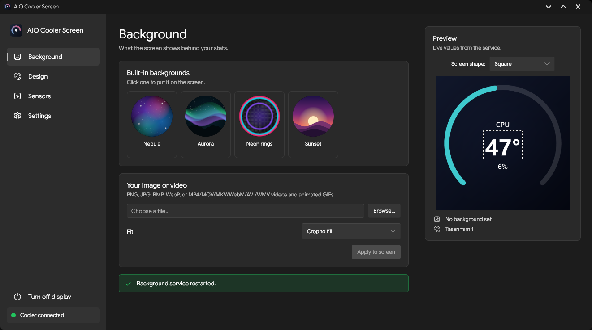
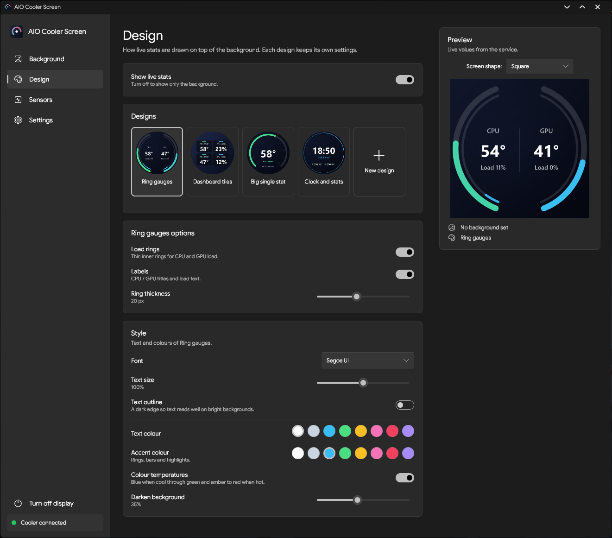
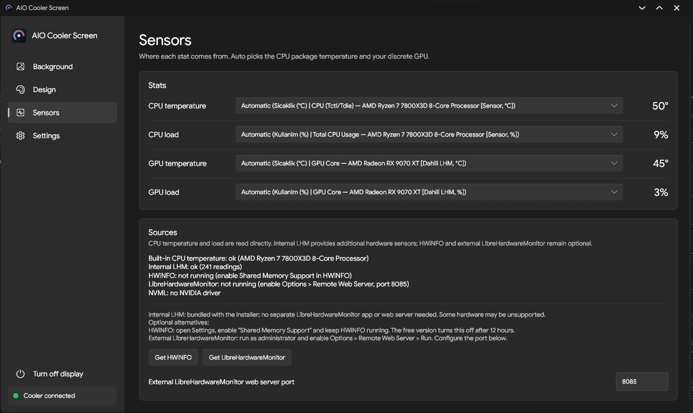
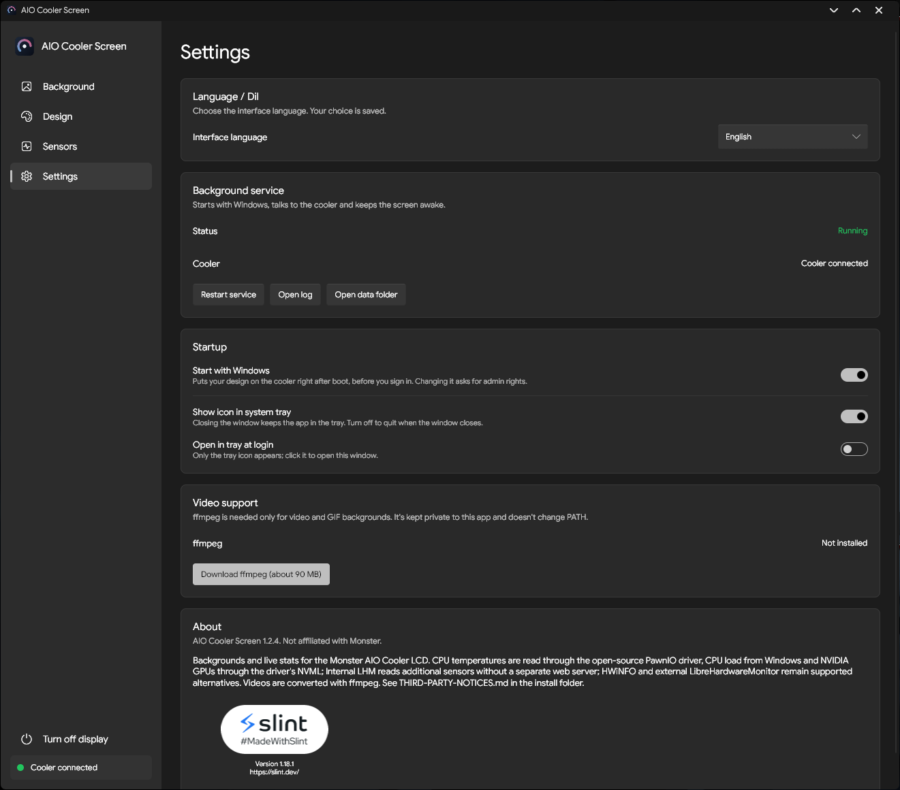

# AIO Cooler Screen — v1.2.4-Fork

[**Türkçe**](TURKCE-README.md) · [Original project](https://github.com/Thnorty/aio-cooler-screen) · [Releases](https://github.com/SefaMeert/aio-cooler-screen/releases)

A Windows application for the LCD screens on compatible **Monster AIO liquid coolers** (USB HID `1D6B:0130`). This is a community fork of [Thnorty/aio-cooler-screen](https://github.com/Thnorty/aio-cooler-screen), maintained by SefaMeert; it is not affiliated with Monster. Other brands and LCD protocols are not confirmed to be supported.

## Improvements in this fork

- **Built-in LibreHardwareMonitor:** A bundled .NET 8 sensor helper reads supported hardware sensors without needing to run a separate LibreHardwareMonitor application or HTTP server.
- **More sensor readings:** Depending on the hardware, select CPU clock speeds, Vcore and other voltages, motherboard sensors, temperatures, and fan/pump RPM values.
- **Automatic hardware discovery:** Sensors are discovered dynamically rather than mapped to fixed motherboard models or fan numbers. Users can select the appropriate readings for their system.
- **Clearer sensor selection:** Human-readable hardware and sensor names in the Sensors page and design editor, while saved designs preserve stable sensor keys.
- **Original sensor sources retained:** Built-in CPU/GPU sensors, optional HWiNFO shared memory and external LibreHardwareMonitor HTTP remain available. The external LHM port can still be configured (default `8085`).
- **English and Turkish localization:** Language selection for the application, sensor UI, system tray menu and Windows installer.
- **Additional LCD fonts:** Eight more font families, including Inter, Orbitron and JetBrains Mono, while retaining existing font identifiers and designs.
- **UI and design refinements:** Improved text/font handling, translations, layout details and square LCD design preview.
- **Installer and Windows-service improvements:** More reliable handling of running application, service and sensor-helper processes when upgrading, plus a bilingual installer.

Sensor availability and hardware permissions vary. Reading fan/pump RPM does **not** provide fan-speed control. For setup and troubleshooting, see the [sensor guide](SENSOR-GUIDE.md).

## Features from the original application

- **480 × 480 LCD backgrounds:** Four presets — Nebula, Aurora, Neon Rings and Sunset — as well as custom PNG, JPG, BMP, WebP, animated GIF and video files (such as MP4, MOV, MKV and WebM). Choose fill, fit or stretch.
- **Four ready-made stat layouts:** Ring gauges, dashboard tiles, a single large stat, and a clock with stats; customizable colors, fonts, sizes, outlines and background dimming.
- **Custom design editor:** Position text, sensor values, ring gauges, progress bars, date and time on a live preview; choose the readings shown by each widget.
- **Live CPU/GPU information:** Built-in CPU temperature and load readings, NVIDIA GPU temperature and load through NVML, and optional extended monitoring sources.
- **Background Windows service:** Drives the LCD from startup, maintains the display and reconnects after sleep; startup behavior can be configured.
- **System tray controls:** Open the app, show live stats, turn the display off and quit; the tray icon follows the Windows theme.
- **Display power control:** Turn the LCD off/on from the app or tray, preserving the off setting across restarts.
- **Windows appearance:** Light/dark appearance follows the Windows theme.
- **Optional FFmpeg:** Enables video and animated backgrounds; can be installed by the application without changing the system `PATH`.

## Screenshots

### Background

### Design

### Sensors

### Settings

## Installation

1. Download **`AIO-Cooler-Screen-Setup-1.2.4-Fork.exe`** from [Releases](https://github.com/SefaMeert/aio-cooler-screen/releases/tag/v1.2.4-Fork) and run it on **Windows 10/11 x64**. Select English or Turkish in the installer. The full setup includes the Windows service, internal sensor helper and additional LCD fonts.
2. Close the official Monster LCD software before using AIO Cooler Screen to avoid competing USB connections.
3. Open AIO Cooler Screen, select a background and layout, then choose your preferred readings on the Sensors page. Video/animated backgrounds may require optional FFmpeg.

The separately downloadable `aio-screen.exe` is intended for advanced use and **does not include all components** supplied by the full installer.

**Smart App Control notice:** This release is not digitally signed. Windows 11 Smart App Control may block it on some computers, as observed during testing; this does not mean every computer with Smart App Control enabled will be affected. Whether to keep Smart App Control enabled or disable it is the user's decision. Code signing is being investigated.

## Further documentation

[Hardware sensor guide](SENSOR-GUIDE.md) · [Build and installer guide](FORK-BUILD-README.md) · [Additional fonts](FONT-README.md) · [Third-party notices](THIRD-PARTY-NOTICES.md)

The original MIT license is retained in [LICENSE](LICENSE). The bundled LibreHardwareMonitor component has separate MPL-2.0 obligations, documented in the third-party notices.
