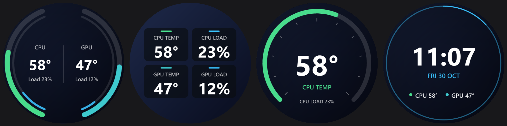
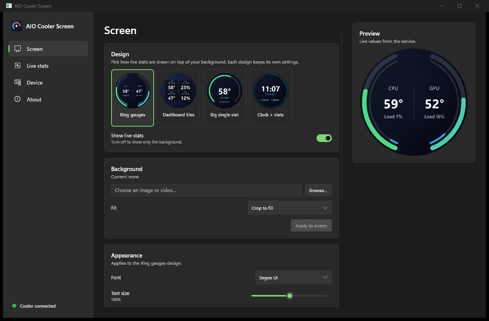

# AIO Cooler Screen

An open-source Windows app for the LCD on **Monster AIO liquid coolers** (USB HID `1D6B:0130`).
Put any image or video on the pump screen and overlay live CPU/GPU stats, without the
official app.





## Features

- **Backgrounds:** PNG, JPG, BMP, WebP images, and MP4/MOV/MKV/WebM/AVI/WMV videos or animated GIFs.
  Crop to fill, fit inside, or stretch to the 480×480 screen.
- **Four stat designs:** ring gauges, dashboard tiles, one big stat, and clock + stats.
  Each design has its own font, text size, outline, colours, background dimming and
  design-specific options.
- **Live sensors:** CPU and GPU temperature and load from HWiNFO or LibreHardwareMonitor,
  plus NVIDIA GPUs directly through the driver. Pick any sensor for each stat.
- **Starts with Windows:** a background service drives the screen from boot, keeps it awake
  and wakes it again after sleep, with no admin prompts.
- **Windows 11 look:** light/dark mode follows Windows.

## Install

1. Download `AIO-Cooler-Screen-Setup-x.y.z.exe` from [Releases](../../releases) and run it.
   Tick **Download ffmpeg** if you want video backgrounds and don't have ffmpeg already.
2. **Close the official Monster app** (or uninstall it). Both apps would drive the screen.
3. Set up a sensor source (below), open **AIO Cooler Screen** from the Start menu, pick a
   design and a background.

Requires Windows 10/11 (64-bit).

## Sensors

CPU temperatures need a hardware monitor with a kernel driver, so AIO Cooler Screen reads them
from one you run. It detects these automatically:

| Source | Setup |
| --- | --- |
| [HWiNFO](https://www.hwinfo.com/download/) | Settings → enable **Shared Memory Support**, keep HWiNFO running (the sensor window can be closed). The free version switches this off after 12 hours. |
| [LibreHardwareMonitor](https://github.com/LibreHardwareMonitor/LibreHardwareMonitor/releases) | Run as administrator, then **Options → Remote Web Server → Run** (default port 8085; change it on the Device page if needed). |
| NVIDIA GPUs | Read directly through NVML from the NVIDIA driver; nothing to set up. |

The **Live stats** page lets you choose which reading feeds each stat; **Auto** picks the CPU
package temperature and your discrete GPU.

## ffmpeg

Only video and GIF backgrounds need [ffmpeg](https://ffmpeg.org/). If one is on `PATH`, it's used
as is. Otherwise the installer or the app's Device page can download the
[gyan.dev release essentials build](https://www.gyan.dev/ffmpeg/builds/), check it against the
published SHA-256, and keep it private to the app in `C:\Program Files\AIO Screen\ffmpeg`.
PATH isn't changed, and uninstalling removes it.

## Build from source

Requirements: [Rust](https://rustup.rs) (MSVC toolchain) and, for the installer,
[Inno Setup 6](https://jrsoftware.org/isdl.php).

```powershell
cargo test
cargo build --release              # target\release\aio-screen.exe
.\build-installer.ps1              # dist\AIO-Cooler-Screen-Setup-<version>.exe
```

`aio-screen.exe` is the GUI. The installer registers it as the `AioScreen` service with
`aio-screen.exe install`. Other commands: `uninstall`, `fetch-ffmpeg`, `dump-sensors <file>`,
`make-icon <dir>`.

## How it works

The cooler is a USB HID device that takes 1024-byte reports. [`src/protocol.rs`](src/protocol.rs)
documents the protocol, which was worked out from USB traffic:

- **Text frames** carry HTTP-like commands with a JSON body, an 8-bit checksum and byte stuffing.
- **Binary frames** carry file uploads in 1000-byte blocks.
- **Connect handshake:** `POST conn`, then `POST power {"event":"resume"}`.
- **Uploads:** the background is a PNG or MP4. The stats overlay is a transparent PNG
  re-sent every second, which also keeps the screen from blanking.

| Module | What it does |
| --- | --- |
| [`device.rs`](src/device.rs) | Talks to the cooler. |
| [`overlay.rs`](src/overlay.rs) | Draws the designs (tiny-skia + ab_glyph). |
| [`sensors.rs`](src/sensors.rs) | Reads HWiNFO, LibreHardwareMonitor and NVML. |
| [`service.rs`](src/service.rs) | The Windows service. |
| [`gui.rs`](src/gui.rs) + [`ui/app.slint`](ui/app.slint) | The app. |

## Disclaimer

This is an independent project and is not affiliated with or endorsed by Monster Notebook /
Monster Bilgisayar. Product names are trademarks of their owners. It talks to your cooler
using a protocol worked out from observing USB traffic; use it at your own risk.

## License

[MIT](LICENSE). The UI is built with [Slint](https://slint.dev) under its royalty-free
licence (credited on the About page). ffmpeg isn't bundled; when downloaded, it's a separate
program under its own (GPL) licence.
