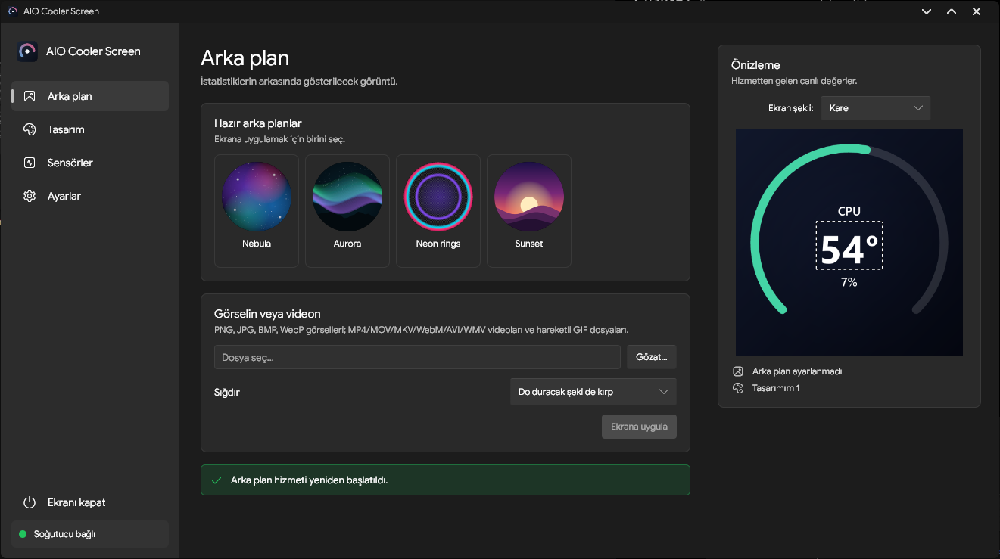
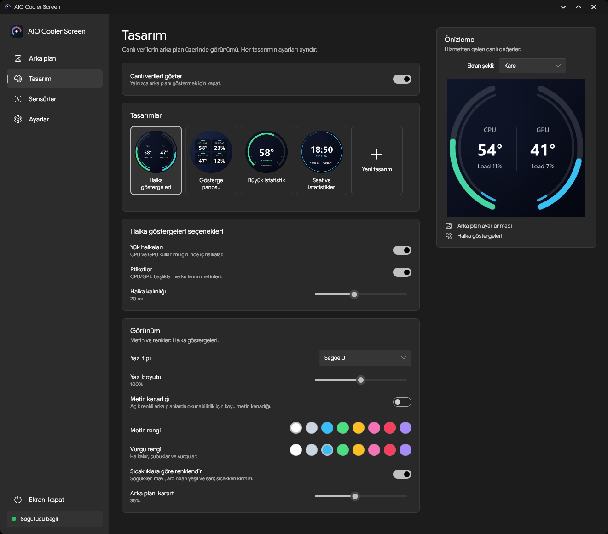
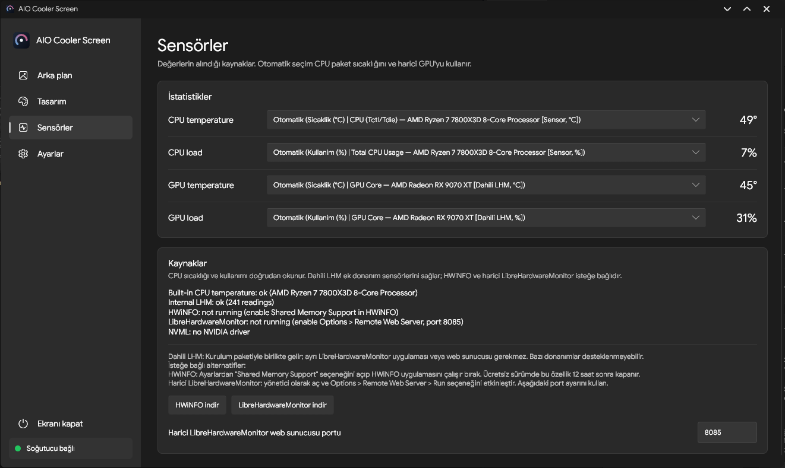
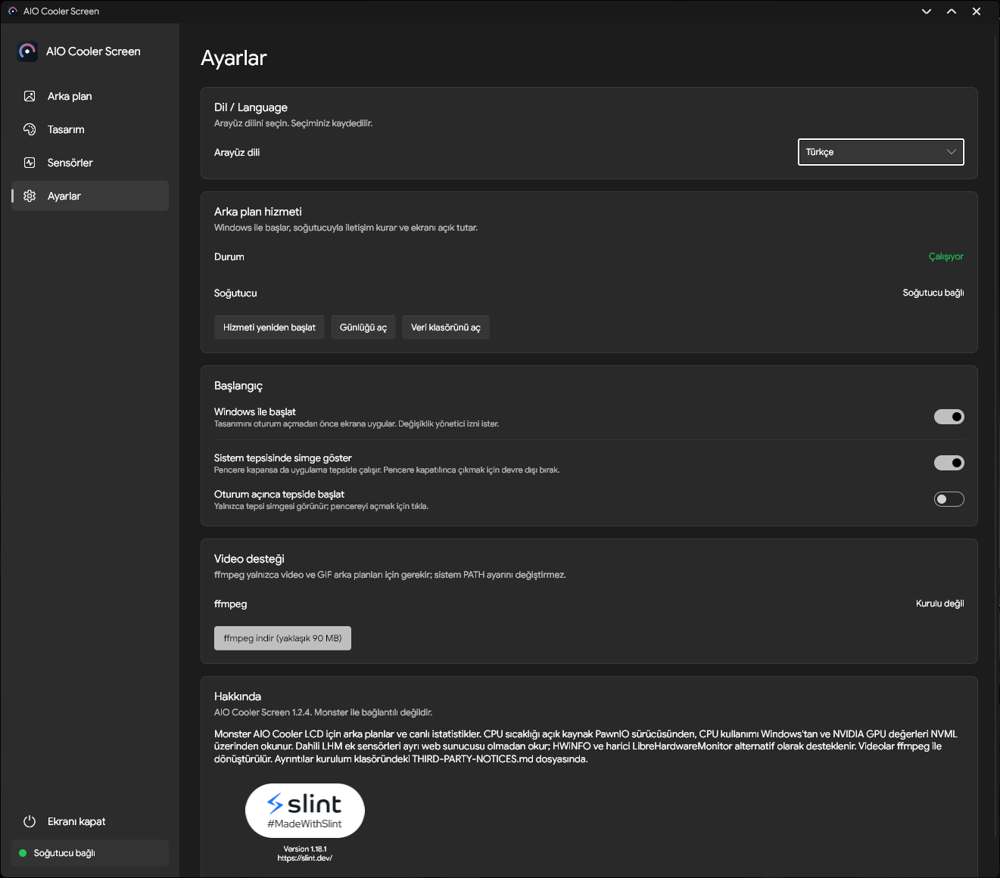

# AIO Cooler Screen — v1.2.4-Fork

[**English**](README.md) | [Orijinal proje](https://github.com/Thnorty/aio-cooler-screen) | [Derleme ve kurulum](FORK-BUILD-README.md) | [Sensör rehberi](SENSOR-GUIDE.md)

Uyumlu Monster AIO soğutucuların LCD ekranları (USB HID `1D6B:0130`) için Windows uygulaması. **Thnorty/aio-cooler-screen** projesinin SefaMeert tarafından geliştirilen bağımsız fork'udur. Monster ile resmî bağlantısı yoktur.

## Özellikler

- 480 × 480 LCD için görsel, animasyonlu GIF ve video arka planları (isteğe bağlı FFmpeg).
- Hazır tasarımlar ve metin, değer, gösterge, katman ve ilerleme çubuğu içeren özel tasarım düzenleyicisi.
- Canlı CPU/GPU bilgileri ve Windows arka plan hizmeti.
- **Dahili donanım sensörleri:** Birlikte gelen .NET / LibreHardwareMonitor yardımcısıyla, ayrı bir LHM web sunucusu olmadan desteklenen frekans, voltaj, sıcaklık ve fan/pompa RPM değerlerini okuma.
- Kayıtlı tasarımlardaki kararlı sensör kimliklerini koruyan anlaşılır sensör adları.
- Diğer donanımlar için isteğe bağlı **harici LibreHardwareMonitor HTTP (varsayılan port 8085)** ve **HWiNFO paylaşımlı bellek** kaynakları.
- **Türkçe ve İngilizce** uygulama, sistem tepsisi ve kurulum arayüzü; ek yazı tipleri ve Windows derleme iş akışı.

Sensörlerin kullanılabilirliği donanıma göre değişir. Fan/pompa RPM değerlerinin okunabilmesi fan hızının kontrol edilebildiği anlamına gelmez.

## Ekran Görüntüleri

### Arka Plan

### Tasarım

### Sensörler

### Ayarlar

## Kurulum

Windows 10/11 x64 üzerinde **tam kurulum paketini** kullanın. Paket Windows hizmetini ve dahili sensör yardımcısını yükler. Tek başına EXE tam kurulum yerine geçmez. USB cihaz çakışmalarını önlemek için orijinal Monster yazılımını kapatın.

**İmzasız sürüm:** Smart App Control veya kurumsal uygulama denetimi kurulum dosyasını ya da sensör yardımcısını engelleyebilir. Çalıştırmak için Windows güvenlik korumasını kapatmayın. Tek bir bilgisayarda başarılı test bütün donanımlarda uyum garantisi değildir.

## Ayrıntılı belgeler

[Sensör rehberi](SENSOR-GUIDE.md) · [Derleme ve paketleme](FORK-BUILD-README.md) · [Yazı tipleri](FONT-README.md) · [Üçüncü taraf lisansları](THIRD-PARTY-NOTICES.md)

Orijinal geliştiricinin MIT lisansı [LICENSE](LICENSE) dosyasında korunmaktadır. Dahili LibreHardwareMonitor dahil ek bileşenlerin lisansları için üçüncü taraf bildirimlerine bakın.
